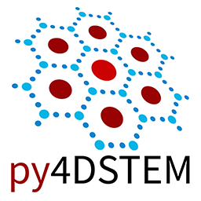

# The `py4DSTEM` GUI

This repository hosts the `pyqt` based graphical 4D--STEM data browser that was originally part of **py4DSTEM** until version 0.13.11.

## Installation
The GUI is available on PyPI and conda-forge:

`pip install py4D-browser`

`conda install -c conda-forge py4d-browser`

## Usage
Run `py4DGUI` in your terminal to open the GUI. Then just drag and drop a 4D-STEM dataset into the window!

### Controls
* Move the virtual detector and the real-space selector using the mouse or using the keyboard shortcuts: WASD moves the detector and IJKL moves the selector, and holding down shift moves 5 pixels at a time. Double-clicking in the diffraction or virtual-image pane jumps the detector or selector so that its center is on the clicked point.
* Auto scaling of both views is on by default. Press the "Autoscale" buttons in the bottom right to disable. Press either button to apply automatic scaling once, or Shift + click to lock autoscaling back on.
* Different shapes of virtual detector are available in the "Detector Shape" menu, and different detector responses are available in the "Detector Response" menu.
* The information in the bottom bar contains the details of the virtual detector used to generate the images, and can be entered into py4DSTEM to generate the same image.
* The FFT pane can be switched between displaying the FFT of the virtual image and displaying the [exit wave power cepstrum](https://doi.org/10.1016/j.ultramic.2020.112994).
* Virtual images can be exported either as the scaled and clipped displays shown in the GUI or as raw data. The exact datatype stored in the raw TIFF image depends on both the datatype of the dataset and the type of virtual image being displayed (in particular, integer datatypes are converted internally to floating point to prevent overflows when generating any synthesized virtual images).

## Configuration

Preferences and UI state are stored in a single INI file (`GUI_config.ini` in the platform user-config directory). [CONFIG.md](CONFIG.md) documents every setting the browser and its built-in plugins read, and how plugins should use the shared settings object.

## New in Version 1.6

* **Virtual image tabs** — the virtual-image pane now holds multiple tabs. Switch between them with Ctrl+Tab / Ctrl+Shift+Tab.
* **3D volumes** — a tab can display a 3D volume in an interactive view (orbit, pan, zoom) with color and alpha transfer functions and a voxel-size slider. With a volume tab visible, the result pane can render its 3D FFT, kept in sync with the volume.
* **Copy to clipboard** — Ctrl+C copies the virtual image, Ctrl+Alt+C the diffraction pattern, and Ctrl+Shift+C the result pane.
* **Debug console** — Ctrl+Shift+D opens a Python console, with full access to the DataViewer object.
* The keyboard map in the Help menu is now rendered in-app (Help → Show Keyboard Map).

## Plugin interface

As of version 1.3.0, the browser supports plugins that extend its functionality. The current **v1.6** plugin API lets a plugin add virtual-image tabs and 3D volume tabs, set scale bars, respond to data and result updates, and place ROIs on the built-in views. A few plugins ship with the browser and make good examples:

* **Calibration** — calibrates the scale bars using known physical distances.
* **Copy Image to Tab** — copies the currently-displayed virtual image or diffraction pattern into a new tab.
* **Volume Viewer** - open a TIFF image stack in a volume tab. 
* **Open Raw** - Open arbitrary raw data files. (Note: the GUI can read EMPAD-G1 `*.raw` files by drag and drop; other raw files need to be opened manually with this menu.)

> [!NOTE]
> The original plugin interface (v1.3-1.5) was experimental, and gave direct access to the entire DataViewer object. As of v1.6 there is now a (fingers-crossed) stable plugin API. Plugins built for v1.3 will not work under v1.6 unless modified. The plugin API object acts as an interposer between the DataViewer and the plugin; plugins now declare the API version they were built against and will always be passed a compatible API layer. See [PLUGINS.md](PLUGINS.md) for details. 

<!-- Github markdown special doodads: https://docs.github.com/en/get-started/writing-on-github/getting-started-with-writing-and-formatting-on-github/basic-writing-and-formatting-syntax#alerts -->

## About

**py4DSTEM** is an open source set of python tools for processing and analysis of four-dimensional scanning transmission electron microscopy (4D-STEM) data. Additional information:

- [Our open access py4DSTEM publication in Microscopy and Microanalysis](https://doi.org/10.1017/S1431927621000477) describing this project and demonstrating a variety of applications.
- [The py4DSTEM documentation pages](https://py4dstem.readthedocs.io/en/latest/index.html).
- [Our open access 4D-STEM review in Microscopy and Microanalysis](https://doi.org/10.1017/S1431927619000497) describing this project and demonstrating a variety of applications.

### License

GNU GPLv3

**py4DSTEM** is open source software distributed under a GPLv3 license.
It is free to use, alter, or build on, provided that any work derived from **py4DSTEM** is also kept free and open.
